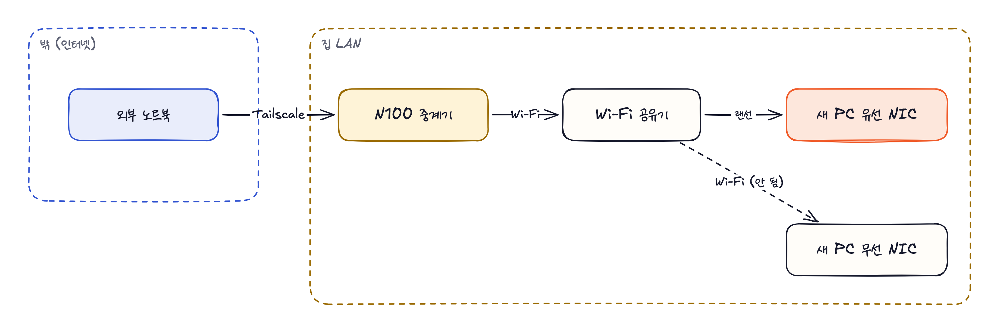

## 개요

Windows + WSL2 환경에서 작업하다 문득 "어차피 이렇게 격리된 환경에서 개발할 거면, 미니PC 한 대를 개발용으로 따로 쓰는 거랑 뭐가 다르지?"라는 생각이 들어서 개발용 미니PC를 샀습니다.


50만 원대 PC를 인플루언서 쿠폰에 광군제 쿠폰까지 얹어서 38만 원대에 샀는데, 통관하면서 세금이 3만 원 정도 붙어 결국 41만 원 남짓 들었습니다.

집에 24시간 켜 두는 N100 서버가 이미 있긴 하지만, 저전력 4코어라 개발까지 맡기기엔 버거웠습니다.

새 PC는 Claude Code Remote Control로 밖에서도 접속해서 개발할 때만 쓸 생각이었습니다.
전기를 꽤 먹는 녀석이라 계속 켜 두긴 아깝고, 필요할 때만 켜고 싶었습니다.
그래서 찾아본 게 꺼진 PC를 네트워크로 켜는 Wake-on-LAN(WOL)입니다.

설정법은 검색하면 금방 나오니까, 이 글에서는 "그래서 이게 왜 되는데?"를 따라가 보려고 합니다.

- 꺼진 PC가 어떻게 패킷을 받아 켜지는지
- 매직 패킷은 어떻게 생겼고, 왜 같은 LAN 안에서만 전달되는지
- Tailscale 같은 VPN으로는 왜 꺼진 PC를 못 깨우는지
- 유선은 되는데 Wi-Fi는 왜 잘 안 되는지

## 꺼진 미니PC는 어떻게 패킷을 받을까

처음 든 의문은 이거였습니다.
**운영체제가 꺼져 있으면 네트워크 스택도 없는데, 패킷(요청)을 누가 받지?**

TCP/IP는 운영체제 커널이 처리합니다.
커널이 내려가 있으면 IP 주소도 없고 소켓도 없습니다.
그런데도 PC가 켜진다는 건, 운영체제보다 아래에서 누군가 패킷을 보고 있다는 뜻입니다.

그 누군가가 랜카드(NIC)입니다.
PC 전원을 꺼도 전원선이 꽂혀 있으면 메인보드에는 대기 전력이 흐르는데(이번에 처음 알았습니다), WOL을 지원하는 랜카드는 이 전기로 최소한의 회로만 살려 둔 채 들어오는 패킷을 지켜봅니다.

IP는 몰라도 L2에서 패킷을 읽는 건 원래 랜카드가 하던 일이라 가능한 겁니다.

약속된 모양의 패킷이 들어오면 랜카드가 메인보드에 "전원 켜 줘" 신호를 보내고, 전원 버튼을 누른 것처럼 부팅이 시작됩니다.


경로가 이렇게 생겼으니, 중간에 하나라도 막혀 있으면 안 켜집니다.
랜카드가 감시 모드로 켜져 있어야 하고, 운영체제가 랜카드의 깨우기를 막지 않아야 하고, BIOS도 랜카드가 전원을 켜는 걸 허락해야 합니다.
나중에 할 설정도 결국 이 세 군데를 여는 일입니다.

<details>
<summary>관련 개념: 랜카드(NIC)</summary>

컴퓨터를 네트워크에 연결하는 장치입니다.
이름은 "카드"지만 요즘은 대부분 메인보드에 칩으로 붙어 있다고 합니다.

OSI 7계층으로 보면 L2(데이터 링크)까지가 랜카드 몫입니다.
케이블로 들어온 신호를 이더넷 프레임(L2에서 부르는 패킷 단위)으로 만들고, 목적지 MAC 주소를 확인합니다.

자기 MAC이거나 브로드캐스트인 것만 운영체제로 올리고 나머지는 버립니다.

IP나 포트는 그 위, 커널의 TCP/IP 스택이 보는 정보라 랜카드는 신경 쓰지 않습니다.
WOL은 이 "MAC만 보고 거르는" 능력을 운영체제 없이 쓰는 셈입니다.

</details>

<details>
<summary>관련 개념: MAC 주소</summary>

랜카드마다 붙는 48비트(6바이트) 주소로, `AA:BB:CC:DD:EE:FF`처럼 씁니다.
제조할 때 랜카드에 기록돼서 원칙적으로 전 세계에서 하나뿐입니다.

IP는 어느 네트워크에 붙느냐에 따라 바뀌지만 MAC은 랜카드에 고정입니다.

헷갈리기 쉬운 건 MAC이 **PC가 아니라 랜카드마다** 있다는 점입니다.
제 PC처럼 유선·무선 랜카드가 둘 다 있으면 MAC도 두 개고, 매직 패킷에는 실제로 깨우기를 기다리는 쪽(제 경우 유선)의 MAC을 넣어야 합니다.

Linux에서는 `ip link`로 볼 수 있습니다.

```bash
$ ip link show enp2s0
2: enp2s0: <BROADCAST,MULTICAST,UP,LOWER_UP> ...
    link/ether aa:bb:cc:dd:ee:ff brd ff:ff:ff:ff:ff:ff
```

`link/ether` 뒤가 MAC 주소, `brd` 뒤의 `ff:ff:ff:ff:ff:ff`가 브로드캐스트 주소입니다.

</details>

<details>
<summary>관련 개념: 랜카드는 어떻게 전원을 켤까 (PCIe·PME)</summary>

랜카드는 메인보드 안에서 PCIe로 CPU·칩셋과 연결돼 있다고 합니다.
그래픽카드나 NVMe SSD가 꽂히는 그 통로입니다.

PCIe에는 장치가 "깨울 일이 생겼다"고 알리는 신호가 정해져 있는데, 이게 PME(Power Management Event)입니다.
매직 패킷을 받은 랜카드가 PME를 보내면 메인보드가 전원을 켭니다.

장치가 아무 때나 PC를 켜면 곤란하니, 이 신호는 허락해 둔 경우에만 통합니다.
뒤에서 켤 운영체제의 `power/wakeup`과 BIOS의 `Power On By PCI-E`가 그 허락 스위치입니다.

</details>

## 매직 패킷의 구조

랜카드가 기다리는 "약속된 모양"이 매직 패킷입니다.
생각보다 단순합니다.

`FF`를 6바이트 보내고, 깨울 PC의 MAC 주소를 16번 반복하면 끝입니다.
다 합쳐 102바이트입니다.

```text
FF FF FF FF FF FF                 ← 동기화 6바이트
AA BB CC DD EE FF                 ← 대상 MAC 주소
AA BB CC DD EE FF
... (총 16번 반복)
```

보통 UDP 9번이나 7번 포트로 보내는데, 포트 번호는 사실 아무 의미가 없습니다.
랜카드는 IP 헤더도 포트도 해석하지 않고, 패킷 안에 이 바이트 패턴이 있는지만 보기 때문입니다.

UDP는 그냥 이 바이트 덩어리를 실어 보내는 포장지 역할입니다.

```python
import socket

MAC = "AA:BB:CC:DD:EE:FF"
packet = b"\xff" * 6 + bytes.fromhex(MAC.replace(":", "")) * 16

s = socket.socket(socket.AF_INET, socket.SOCK_DGRAM)
s.setsockopt(socket.SOL_SOCKET, socket.SO_BROADCAST, 1)
s.sendto(packet, ("192.168.0.255", 9))   # 같은 LAN의 브로드캐스트 주소
```

<details>
<summary>관련 개념: 패킷이란 (프레임·세그먼트와의 차이)</summary>

패킷은 네트워크로 보내는 데이터를 잘게 나눈 한 덩어리입니다.
큰 파일도 한 번에 가지 않고 작은 조각으로 나뉘어 가는데, 그 조각 하나하나가 패킷입니다.

각 조각은 **헤더 + 데이터(페이로드)** 로 생겼습니다.
헤더는 택배 송장처럼 "어디서 와서 어디로 가는지"를 적어 두는 부분이고, 페이로드가 실제 내용물입니다.

엄밀히 따지면 계층마다 부르는 이름이 다릅니다.

| 계층 | 이름 | 헤더에 담긴 주소 |
|---|---|---|
| L4 (전송) | 세그먼트(TCP) / 데이터그램(UDP) | 포트 번호 |
| L3 (네트워크) | 패킷 | IP 주소 |
| L2 (데이터 링크) | 프레임 | MAC 주소 |

데이터를 보낼 때는 위 계층부터 헤더를 하나씩 덧붙여 감쌉니다(캡슐화). 매직 패킷이라면 이렇게 됩니다.

```text
[이더넷 헤더 | IP 헤더 | UDP 헤더 | FF×6 + MAC×16 ]
 └ MAC 주소   └ IP 주소  └ 포트     └ 매직 패킷 본체 (102바이트)
```

받는 쪽은 반대로 바깥 헤더부터 벗겨 가며 위 계층으로 올립니다.
평소엔 이 일을 커널이 하지만, 꺼진 PC의 랜카드는 헤더를 벗길 필요도 없이 통째로 훑어서 가운데 102바이트 패턴만 찾습니다.
그래서 IP나 포트가 뭐든 상관없는 겁니다.
(실제로 IP·UDP 없이 이더넷 프레임에 바로 실어 보내는 방식도 있습니다.)

일상적으로는 계층을 따지지 않고 전부 "패킷"이라고 부르는 경우가 많아서, 이 글에서도 패킷으로 통일했습니다.

</details>

## 왜 같은 LAN 안에서만 전달될까

그럼 이 패킷을 어디로 보내야 할까요?
꺼진 PC의 IP로 보내면 될 것 같지만, 그게 안 됩니다.

같은 LAN에서 IP로 패킷을 보내려면 먼저 ARP로 "이 IP 가진 사람 MAC 주소가 뭐야?"라고 물어봐야 합니다.
그런데 대답해 줄 운영체제가 꺼져 있습니다.

목적지 MAC을 모르니 보낼 곳을 정할 수가 없고, 한 대에만 보내는 유니캐스트는 여기서 막힙니다.
(공유기 ARP 캐시에 예전 기록이 남아 있으면 운 좋게 가기도 하지만, 믿을 건 못 됩니다.)

그래서 매직 패킷은 브로드캐스트로 보냅니다.
목적지를 모르면 다 뿌리면 됩니다.

같은 네트워크의 모든 장비가 받게 되고, 그중 대상 랜카드가 안에서 자기 MAC을 찾아냅니다.

문제는 브로드캐스트가 라우터를 못 넘는다는 점입니다.
브로드캐스트는 L2 범위, 그러니까 같은 공유기·스위치 아래에서만 퍼지고 라우터는 이걸 다른 네트워크로 넘기지 않습니다.

넘겼다간 인터넷 전체가 브로드캐스트로 뒤덮일 테니까요.
결국 매직 패킷은 깨울 PC와 같은 LAN 안에서 출발해야 합니다.

## Tailscale로는 왜 못 깨울까

밖에서 집 PC에 붙을 때 Tailscale을 쓰고 있었으니, 처음엔 "Tailscale로 매직 패킷 보내면 되겠네" 싶었습니다.
그런데 앞의 내용을 생각하면 안 되는 게 당연합니다.

- Tailscale은 각 기기에서 도는 데몬이 만드는 L3(IP) 터널입니다. PC가 꺼지면 데몬도 꺼지니, 그 PC로 가는 터널 자체가 없습니다.
- 터널이 살아 있다 쳐도 Tailscale은 IP 패킷을 실어 나를 뿐, 집 LAN에 브로드캐스트를 뿌려 주지 않습니다.

그러면 답은 하나입니다.
같은 LAN에 항상 켜져 있는 기기를 하나 두고, 밖에서는 Tailscale로 그 기기에 접속한 다음, 그 기기가 LAN 안에서 브로드캐스트하게 하면 됩니다.

저는 원래 24시간 돌던 N100 서버에 이 중계 역할을 맡겼습니다.



N100은 Wi-Fi로 붙어 있지만 상관없습니다.
보내는 쪽은 켜져 있으니 LAN에 브로드캐스트만 하면 되고, 중요한 건 받는 쪽인 새 PC가 어떤 랜카드로 기다리느냐입니다.
이건 아래 Wi-Fi 얘기에서 다시 나옵니다.

실제로 꺼 둔 새 PC를 N100을 거쳐 깨워 보니, 매직 패킷을 보내고 8초쯤 뒤 부팅이 시작됐고, 보낸 시점부터 10초 남짓이면 SSH로 들어갈 수 있었습니다.

중계를 꼭 별도 서버가 맡아야 하는 건 아닙니다.
공유기도 LAN 안에서 항상 켜져 있는 기기라, 공유기가 WOL을 지원하면 공유기에 맡겨도 됩니다.

- **공유기 내장 WOL**: ipTIME 같은 공유기는 관리 페이지나 앱에 WOL 메뉴가 있습니다. 깨울 PC의 MAC을 등록해 두고 버튼을 누르면 공유기가 LAN에 매직 패킷을 뿌려 줍니다. 대신 밖에서 쓰려면 공유기 관리 페이지를 외부에 열어야 해서 보안은 신경 써야 합니다.
- **포트포워딩**: 외부 UDP 9번 포트를 집 안 PC로 넘기는 방법입니다. 다만 PC가 꺼져 있으면 공유기도 ARP로 MAC을 못 알아내니, IP와 MAC을 고정으로 묶어 두거나(정적 ARP) 브로드캐스트 주소로 넘겨야 합니다. 공유기에 따라 이런 설정을 막아 두기도 합니다.

저는 이미 Tailscale로 N100에 접속하고 있었으니, 공유기를 외부에 열지 않고 N100을 쓰는 쪽을 택했습니다.

## 유선은 되고 Wi-Fi는 잘 안 되는 이유

새 PC에는 유선·무선 랜카드가 둘 다 있었고, 처음엔 집에 쓸 만한 랜선이 없어서 Wi-Fi로 WOL을 시도했습니다.
Wi-Fi 버전은 WoWLAN(Wake-on-Wireless-LAN)이라고 부르는데, 결론부터 말하면 서버를 원격으로 켜는 용도로는 믿기 어렵습니다.

차이는 연결 방식에서 나옵니다.
유선은 케이블로 공유기와 물리적으로 이어져 있어서, 대기 전력만 있으면 패킷이 그냥 들어옵니다.

Wi-Fi는 AP(공유기)와 연결을 맺고 계속 유지해야 패킷을 받을 수 있습니다.
PC가 완전히 꺼지면 이 연결이 끊기니, 받을 방법 자체가 없어집니다.

그래서 같은 "꺼짐"이라도 어떤 상태로 꺼졌느냐에 따라 결과가 갈립니다.

| 상태 | 의미 | 유선 WOL | Wi-Fi WOL |
|---|---|---|---|
| 절전(Suspend) | 메모리만 살려 둔 채 대기 | 가능 | 이론상 가능 |
| 최대 절전(Hibernate) | 메모리 내용을 디스크에 저장하고 꺼짐 | BIOS 지원 시 가능 | 불가 |
| 완전 종료(Shutdown) | 전원 끔 | BIOS 지원 시 가능 | 불가 |

절전 상태라도 Wi-Fi는 불안정합니다.
Wi-Fi 칩과 드라이버 조합에 따라 되고 안 되고가 갈리고, 공유기가 절전 중인 기기에는 브로드캐스트를 늦게 주거나 버리기도 합니다.

제 PC도 운영체제 쪽 설정을 다 켜고 같은 LAN에서 패킷을 몇 번이고 보냈지만 한 번도 안 켜졌습니다.

결국 Wi-Fi는 포기하고 다이소에서 3,000원짜리 랜선을 사 와서 꽂았는데, 유선으로는 완전 종료 상태에서도 바로 켜졌습니다.

## 실제로 설정한 것

원리를 알고 나면 설정은 앞에서 본 깨우기 경로(랜카드 → 운영체제 → BIOS)를 하나씩 여는 일입니다.
새 PC는 Ubuntu Server이고, 유선 랜카드 이름은 `enp2s0`입니다.

**(이 부분은 AI의 도움을 많이 받았습니다. 빠르게 넘어가셔도 좋을 것 같습니다.)**

### 랜카드가 매직 패킷을 감시하게 하기

먼저 랜카드가 WOL을 지원하는지, 지금 켜져 있는지 `ethtool`로 봅니다.

```bash
$ sudo ethtool enp2s0 | grep Wake-on
	Supports Wake-on: pumbg
	Wake-on: d
```

`Supports Wake-on`은 하드웨어가 지원하는 방식, `Wake-on`은 현재 설정입니다.
`d`는 꺼짐(disabled), `g`는 매직 패킷으로 깨우기입니다.

나머지 `p`·`u`·`m`·`b`는 링크 변화나 아무 유니캐스트·멀티캐스트·브로드캐스트 패킷에도 깨는 방식이라, 엉뚱할 때 켜질 수 있어서 보통 `g`만 씁니다.

```bash
sudo ethtool -s enp2s0 wol g
```

이 설정은 재부팅하면 `d`로 돌아가는 경우가 많아서, 부팅할 때마다 다시 켜 주는 systemd 서비스를 만들었습니다.
운영체제가 깨우기를 막지 않도록 sysfs의 `power/wakeup`도 같이 켭니다.

<details>
<summary><code>wol.service</code> 전체 보기</summary>

```ini title="/etc/systemd/system/wol.service"
[Unit]
Description=Enable Wake-on-LAN (magic packet) on enp2s0
After=sys-subsystem-net-devices-enp2s0.device
BindsTo=sys-subsystem-net-devices-enp2s0.device

[Service]
Type=oneshot
ExecStart=/usr/sbin/ethtool -s enp2s0 wol g
ExecStart=/bin/sh -c "echo enabled > /sys/class/net/enp2s0/device/power/wakeup"
RemainAfterExit=yes

[Install]
WantedBy=multi-user.target
```

</details>

```bash
sudo systemctl enable --now wol.service
```

### BIOS에서 허용하기

완전 종료 상태에서 실제로 전원을 켜는 건 메인보드라, BIOS에서도 깨우기를 허용해야 합니다(부팅할 때 F2 같은 키를 눌러 들어가는 그 화면입니다).
앞에서 설정한 `wol.service`는 종료 직전까지 랜카드에 `wol g`를 걸어 두는 역할이라, 둘 다 있어야 완전 종료 상태에서 켜집니다.

항목 이름은 제조사마다 다르지만 보통 `Wake on LAN`이나 `Power On By PCI-E` 같은 이름이고, 이걸 켜면 됩니다.
반대로 `ErP`나 `Deep Sleep` 같은 절전 항목은 꺼야 합니다.

이게 켜져 있으면 종료 상태에서 랜카드로 가는 대기 전력까지 끊어 버려서, 감시할 전기 자체가 없어집니다.

### 유선 랜카드에 IP 주기 (netplan)

Wi-Fi만 쓰던 PC에 랜선을 꽂았더니 엉뚱한 문제가 하나 생겼습니다.
부팅이 2분씩 걸리고, 그동안 SSH로 접속하면 이런 메시지와 함께 튕겼습니다.

```text
System is booting up. Unprivileged users are not permitted to log in yet.
```

원인은 netplan 설정이었습니다.
유선 랜카드 항목에 IP 설정이 없으니 `systemd-networkd-wait-online`이 이 인터페이스가 준비되길 기다리다 2분 뒤 타임아웃됐고, 부팅이 덜 끝난 동안은 `/run/nologin` 파일 때문에 일반 사용자 로그인이 막혀 있었던 겁니다.

`dhcp4: true`로 IP를 받게 하고, `optional: true`로 이 인터페이스 때문에 부팅이 기다리지 않게 하면 해결됩니다.
기존 netplan 파일의 `ethernets` 아래 유선 랜카드 항목에 두 줄만 추가하고, Wi-Fi 설정처럼 원래 있던 건 그대로 둡니다.

```yaml title="/etc/netplan/00-installer-config.yaml" {5-6}
network:
  version: 2
  ethernets:
    enp2s0:
      dhcp4: true
      optional: true
```

SSH로 붙은 채 네트워크 설정을 바꾸는 거라 적용은 `sudo netplan try`로 하는 게 안전합니다.
설정이 잘못돼 접속이 끊겨도, 확인 입력이 없으면 잠시 뒤 이전 설정으로 돌아갑니다.

### 켜졌는지 확인하기

깨운 뒤 켜졌는지 `ping`으로 보면 헷갈릴 수 있습니다.
제 환경에서는 PC가 켜져 있어도 ping에 응답이 없었습니다.

원인까지 파 보진 않았지만, 방화벽이 ICMP를 막고 있으면 이렇게 됩니다.
그래서 SSH 포트가 열렸는지 보는 쪽이 확실합니다.

아래 `192.168.0.10`은 새 PC의 LAN 주소 자리에 넣은 예시값입니다.

```bash
nc -z -w3 192.168.0.10 22 && echo "켜짐"
```

## 정리

정리하면 WOL은 꺼진 PC의 랜카드가 대기 전력으로 매직 패킷을 기다리다가, 자기 MAC을 발견하면 메인보드에 신호를 보내 전원을 켜는 구조입니다.
랜카드, 운영체제, BIOS 중 한 곳이라도 막혀 있으면 패킷이 와도 안 켜지니, 안 될 때는 이 순서대로 확인해 보면 됩니다.

꺼진 PC가 알아듣는 건 MAC 주소뿐이라, 패킷은 같은 LAN 안에서 브로드캐스트로 출발해야 합니다.
밖에서 켜고 싶으면 VPN만으로는 부족하고, 집 안에 항상 켜져 있는 기기가 하나 필요합니다.

저는 원래 있던 N100 서버가 그 자리를 맡아 준 덕분에 새 PC는 필요할 때만 켜서 쓰고 있습니다.

다만 WOL은 결국 하드웨어가 받쳐 줘야 하는 구조입니다.
랜카드에 대기 전력으로 감시하는 기능이 없거나 BIOS에 종료 상태에서 깨우는 설정이 없으면, 소프트웨어로는 손쓸 방법이 없습니다.

Wi-Fi만 있는 기기라면 앞에서 본 것처럼 완전 종료 상태에서 켜는 건 사실상 어렵습니다.

이럴 땐 아예 물리적으로 우회하는 방법도 있습니다.
전원 버튼을 대신 눌러 주는 매직 스위치 같은 IoT 기기를 붙이면, 랜카드나 BIOS 지원과 상관없이 앱으로 PC를 켤 수 있습니다.
결국 사람이 버튼 누르는 걸 대신하는 거라 기기를 가리지 않는다는 게 장점입니다.
